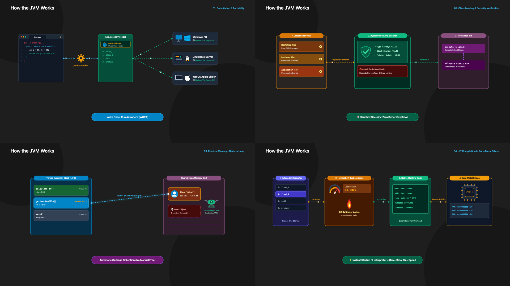
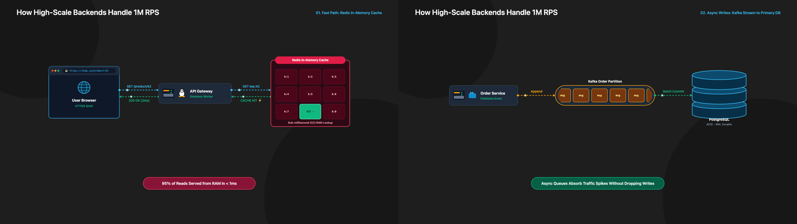

# Tech Video Studio

**[English](./README.md) | [Tiếng Việt](./README.vi.md)**

An **AI-First Motion Graphics Engine & Multi-Agent Skill Kit** for producing high-retention **1080p60 YouTube technical & system design explainer videos** (inspired by ByteByteGo & Fireship visual storytelling).





---

## Why Tech Video Studio?

When asked to generate technical explainer videos from scratch, AI coding agents commonly fail in predictable ways:
- Cramming 50+ text labels into a static 4-column spreadsheet layout.
- Reusing the exact same *"dashed rectangle + 3 inner pills"* container across every scene (visual monotony).
- Writing full sentences inside diagram cards instead of using intuitive physical/schematic metaphors.
- Producing off-center pipelines, overlapping connector labels, or dropped frames from `MediaRecorder`.

**Tech Video Studio** packages both the **reusable HTML5 Canvas + GSAP JavaScript library (`dist/tech-video-studio.bundle.js`)**, a **deterministic 60FPS FFmpeg CLI (`techvid`)**, and a **battle-tested AI Agent Skill (`skills/tech-video-studio/SKILL.md`)** into one repository ready for GitHub and multi-agent installation.

---

## Key Capabilities

- **17 Domain-Specific Visual Primitives** — Realistic IDE Code Editor, Bytecode Capsule (`0xCAFEBABE`), Rotating Compiler Gear, Distinct Hardware Silhouettes (`PC` / `19" Rack Server` / `Laptop`), Multi-Tier Security Vault, Holographic X-Ray Scanner, LIFO Stack Chamber, 3D Heap Grid + Autonomous GC Sweeper Drone, Sequential Tape Reader, HotSpot Tachometer & Nitro Forge, Native Assembly Terminal, Bare-Metal Silicon CPU Die, Web Browser Viewport, 3D Multi-Platter Database, Kafka Message Pipe, and Redis RAM Matrix.
- **Mathematical Symmetry Engine (`Layout`)** — Automatically centers N-stage horizontal pipelines, Left/Right split comparisons, and `1 -> N` fan-out trees across `1920x1080` with equal margins.
- **5-Second Multimodal Visual QA Gate (`techvid qa`)** — Captures peak scene keyframes and stitches a `2x2` `qa_contact_sheet.jpg` so AI vision models inspect spacing, diversity, and legibility before encoding video.
- **Deterministic Frame-Exact 60FPS Renderer (`techvid render`)** — Advances `window.__studioSeek(t)` exact frame-by-frame (`t = frame / 60`) into `ffmpeg -c:v libx264 -crf 18 -pix_fmt yuv420p -movflags +faststart` with optional `-14 LUFS` EBU R128 voiceover mastering. Zero dropped frames.
- **Universal AI Agent Compatibility** — Ships with `plugin.json` (Antigravity), `.claude-plugin/plugin.json` (Claude Code), `skills/tech-video-studio/SKILL.md` (Universal Agent Skills / Codex / Cursor / Gemini CLI), and `AGENTS.md`.

---

## Prerequisites

- **Node.js** `>= 18`
- **Google Chrome / Chromium** installed locally (or set `CHROME_PATH`)
- **FFmpeg** installed (`brew install ffmpeg` on macOS, `apt install ffmpeg` on Linux)

---

## Quick Start

### 1. Clone & Install

```bash
git clone https://github.com/<your-username>/tech-video-studio.git
cd tech-video-studio
npm install
npm test
```

### 2. Install the Skill into Your AI Agent

Install globally into **Google Antigravity / Gemini CLI**, **Claude Code**, **Codex**, or locally into any workspace (`.agents/skills/`):

```bash
# Antigravity / Gemini
node bin/tech-video-studio.js install-skill --target antigravity

# Claude Code
node bin/tech-video-studio.js install-skill --target claude

# Codex
node bin/tech-video-studio.js install-skill --target codex

# Current Workspace (.agents/skills/tech-video-studio)
node bin/tech-video-studio.js install-skill --target local
```

*(Alternatively, open this repository directly as your workspace — `AGENTS.md`, `CLAUDE.md`, and `plugin.json` are discovered automatically.)*

### 3. Prompt Your AI to Generate a YouTube Video

Once the skill is installed, prompt your AI assistant naturally:

> *"Create a 60-second 1080p60 YouTube video explaining How Docker Containers Work Under the Hood (Namespaces, cgroups, OverlayFS vs Heavy VMs) using tech-video-studio."*

> *"Build a 4-scene system design explainer video on Why Redis Is So Fast and render it to MP4."*

---

## CLI Usage (`techvid`)

```bash
# 1. Search diverse visual metaphors for a technical topic
node bin/tech-video-studio.js metaphor "redis cache kafka database"

# 2. Scaffold a new 1080p60 YouTube explainer project
node bin/tech-video-studio.js new ./my-docker-video --title "How Docker Actually Works"

# 3. Capture peak QA keyframes + 2x2 stitched contact sheet
node bin/tech-video-studio.js qa ./examples/jvm-under-the-hood/index.html

# 4. Render deterministic 60FPS H.264 MP4 (with optional voiceover audio)
node bin/tech-video-studio.js render ./examples/jvm-under-the-hood/index.html \
  -o ./output/jvm_explainer_1080p60.mp4 \
  --fps 60
```

---

## Declarative Scene API Example

Instead of writing 900+ lines of raw canvas math, scenes are declared cleanly using `TechVideoStudio`:

```js
const { Theme, Layout, Connectors, Illustrations, createVideo } = window.TechVideoStudio;

createVideo({
  title: 'How High-Scale Backends Handle 1M RPS',
  fps: 60,
  scenes: [
    {
      id: 'redis-fast-path',
      chapter: '01. Fast Path: Redis In-Memory Cache',
      duration: 15,
      initialState: () => ({ browser: 0, api: 0, cache: 0 }),
      build(tl, s) {
        tl.to(s, { browser: 1, duration: 0.6, ease: 'back.out(1.5)' }, 0.3)
          .to(s, { api: 1, duration: 0.6, ease: 'back.out(1.5)' }, 1.2)
          .to(s, { cache: 1, duration: 0.6, ease: 'back.out(1.5)' }, 2.2);
      },
      render(ctx, { state, t }) {
        const pipe = Layout.horizontalPipeline([340, 350, 380], { gap: 190, centerY: 450, height: 320 });
        const [s1, s2, s3] = pipe.stages;
        const [c1, c2] = pipe.connectors;

        Layout.scaleAround(ctx, s1.cx, s1.cy, state.browser, () => {
          Illustrations.browserClient(ctx, s1.x, s1.y + 30, s1.w, 250, { url: 'https://shop.io/item/42' });
        });
        Connectors.bidirectional(ctx, c1.x1, c1.y1, c1.x2, c1.y2, t, {
          reqProgress: state.api, resProgress: state.cache, reqLabel: 'GET /item/42', resLabel: '200 OK (2ms)'
        });
        Layout.scaleAround(ctx, s2.cx, s2.cy, state.api, () => {
          Illustrations.hardwareMachine(ctx, s2.x, s2.cy, { width: s2.w, type: 'server', osIcon: 'linuxPenguin', title: 'API Gateway' });
        });
        Connectors.bidirectional(ctx, c2.x1, c2.y1, c2.x2, c2.y2, t, {
          reqProgress: state.cache, resProgress: state.cache, reqLabel: 'GET k:42', resLabel: 'CACHE HIT ⚡'
        });
        Layout.scaleAround(ctx, s3.cx, s3.cy, state.cache, () => {
          Illustrations.cacheMemoryMatrix(ctx, s3.x, s3.y, s3.w, s3.h, t);
        });
        if (state.cache > 0.5) {
          Theme.drawTakeawayPill(ctx, '95% of Reads Served from RAM in < 1ms');
        }
      }
    }
  ]
});
```

---

## Repository Structure

```text
tech-video-studio/
├── bin/tech-video-studio.js               # CLI: metaphor | new | qa | render | install-skill
├── data/metaphors.json                    # Searchable CS -> Visual Metaphor knowledge base
├── dist/tech-video-studio.bundle.js       # Standalone offline browser bundle (GSAP + Studio)
├── src/
│   ├── core/                              # Theme, Layout symmetry, Connectors, SVG Icons, Runner
│   └── illustrations/primitives.js        # 17 rich domain-specific visual primitives
├── skills/tech-video-studio/              # Portable AI Skill (SKILL.md + references + scripts)
├── examples/
│   ├── jvm-under-the-hood/                # 4-scene JVM Architecture explainer
│   └── http-request-lifecycle/            # High-scale Redis + Kafka + PostgreSQL explainer
├── plugin.json                            # Antigravity Plugin manifest
├── .claude-plugin/plugin.json             # Claude Code Plugin manifest
└── skill.json                             # Multi-agent Skill manifest
```

## License

MIT — see [LICENSE](./LICENSE).
