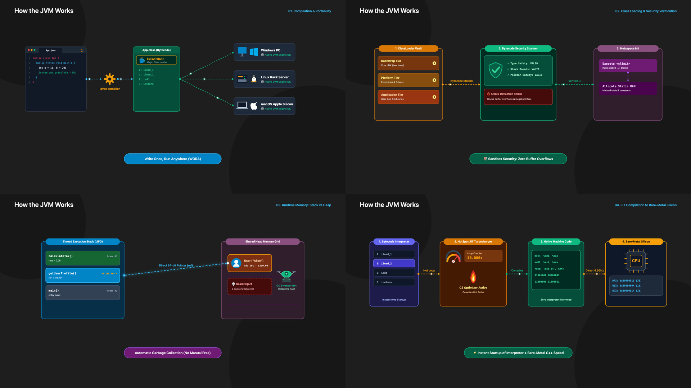
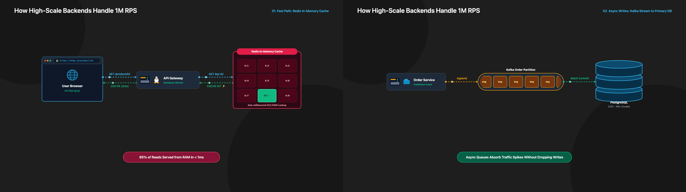

# Tech Video Studio (Bản Tiếng Việt)

**[English](./README.md) | [Tiếng Việt](./README.vi.md)**

**Thư viện Motion Graphics & Bộ AI Skill Đa Nền Tảng** giúp kết hợp cùng AI (Antigravity, Claude Code, Cursor, Codex, Gemini CLI) để tự động thiết kế, kiểm duyệt thị giác và render **video giải thích kiến trúc kỹ thuật chuẩn YouTube 1080p60** (phong cách trực quan ByteByteGo / Fireship).





---

## Giải quyết triệt để các lỗi thường gặp khi dùng AI làm video kỹ thuật

Qua thực tế tinh chỉnh nhiều vòng, khi yêu cầu AI tự viết code tạo video kiến trúc phần mềm từ con số 0, AI thường mắc 6 lỗi kinh điển:
1. **Nhồi nhét chữ như tài liệu (4-Column Wall of Text)**: Đưa 40–60 nhãn chữ lên cùng một màn hình tĩnh gây rối mắt.
2. **Lặp đi lặp lại một mẫu hộp (Box + Pill Fatigue)**: Cảnh nào cũng vẽ khung viền nét đứt kèm 3 thẻ chữ nhật bên trong gây nhàm chán.
3. **Dính watermark kênh khác**: Tự ý chèn logo hoặc tên miền bên thứ ba lên góc video.
4. **Viết cả câu văn dài trong sơ đồ**: Khiến người xem phải đọc chữ thay vì nhìn cơ chế hoạt động.
5. **Lệch bố cục & đè chữ**: Mũi tên đè lên icon bánh răng, sơ đồ lệch hẳn sang trái để trống nửa màn hình phải.
6. **Rớt khung hình (Dropped Frames)**: Quay bằng `MediaRecorder` thời gian thực bị giật/lệch nhịp khi máy tải nặng.

**Tech Video Studio** đóng gói toàn bộ các quy tắc thiết kế, bộ 17 hình minh họa chuyên biệt, công cụ căn giữa toán học `Layout`, cổng kiểm duyệt ảnh `qa_contact_sheet.jpg` và trình xuất video **Deterministic 60FPS FFmpeg** thành một thư viện + AI Skill hoàn chỉnh.

---

## Tính năng nổi bật

- **17 Hình tượng Minh họa Chuyên biệt (`Illustrations`)**:
  - Cửa sổ IDE Code Editor (nút điều khiển macOS, tab file, số dòng, tô màu cú pháp)
  - Bánh răng máy biên dịch xoay (`compilerGear`) & Viên nang Bytecode `0xCAFEBABE` kèm tách cà phê nóng (`bytecodeCapsule`)
  - 3 Thiết bị phần cứng tách biệt: Máy bàn `PC`, Tủ `Rack Server 19"` có đèn LED, `Laptop` mỏng nhẹ (`hardwareMachine`)
  - Hầm bảo mật phân tầng có khóa vàng (`tieredVault`) & Phòng quét X-Ray Hologram kèm khiên chặn tấn công (`xraySecurityScanner`)
  - Buồng thực thi LIFO Stack (`lifoStackChamber`), Tia laser con trỏ 64-bit (`laserBeam`), Lưới bộ nhớ Heap 3D kèm Drone quét rác tự hành (`memoryHeapGrid`)
  - Băng đọc lệnh tuần tự (`sequentialReader`), Đồng hồ đo vòng lặp HotSpot & Ngọn lửa JIT Nitro (`turboForge`), Bảng mã máy Assembly (`nativeAssemblyBlock`), Chip bán dẫn CPU Silicon kèm thanh ghi `RAX/RBX/RCX` (`siliconCpuDie`)
  - Trình duyệt Web HTTPS (`browserClient`), Lưới RAM Redis O(1) (`cacheMemoryMatrix`), Đường ống phân vùng Kafka (`messageQueuePipe`), Ổ đĩa Database 3D nhiều tầng (`isometricDatabase`).
- **Tự động đối xứng bố cục (`Layout`)**: Tự tính toán tọa độ `x, y` để lề trái và lề phải luôn cân đối tuyệt đối trên khung hình `1920x1080`.
- **Cổng kiểm duyệt thị giác (`techvid qa`)**: Xuất ảnh chụp từng phân cảnh và ghép thành bảng `qa_contact_sheet.jpg` (`2x2`) chỉ trong vài giây để AI tự kiểm tra bằng thị giác đa phương thức trước khi render.
- **Render 1080p60 Chính xác Từng Khung hình (`techvid render`)**: Chạy `window.__studioSeek(t)` từng frame chính xác ở `60.00 FPS` truyền thẳng qua `ffmpeg libx264` (hỗ trợ ghép file thu âm `--audio` chuẩn âm lượng YouTube `-14 LUFS`).

---

## Cài đặt & Sử dụng Nhanh

### 1. Cài đặt tại thư mục dự án

```bash
git clone https://github.com/<username-cua-ban>/tech-video-studio.git
cd tech-video-studio
npm install
npm test
```

### 2. Cài đặt Skill cho AI Agent của bạn

```bash
# Cài cho Antigravity / Gemini CLI
node bin/tech-video-studio.js install-skill --target antigravity

# Cài cho Claude Code
node bin/tech-video-studio.js install-skill --target claude

# Cài cho Codex
node bin/tech-video-studio.js install-skill --target codex

# Cài cục bộ vào dự án bất kỳ (.agents/skills/tech-video-studio)
node bin/tech-video-studio.js install-skill --target local
```

### 3. Ra lệnh cho AI tạo video đăng YouTube

Sau khi cài skill, bạn chỉ cần yêu cầu AI bằng tiếng Việt hoặc tiếng Anh:

> *"Hãy dùng skill tech-video-studio tạo một video YouTube 60 giây (1080p60) giải thích Cách Docker Container hoạt động bên dưới (Namespaces, cgroups, OverlayFS so với Virtual Machine) với hình minh họa đa dạng."*

> *"Tạo video 4 phân cảnh giải thích Tại sao Redis lại nhanh đến vậy và xuất ra file MP4."*

---

## Các câu lệnh CLI (`techvid`)

```bash
# Tra cứu ý tưởng hình minh họa đa dạng theo chủ đề
node bin/tech-video-studio.js metaphor "bộ nhớ stack heap gc"

# Khởi tạo nhanh một dự án video mới
node bin/tech-video-studio.js new ./video-docker --title "How Docker Actually Works"

# Chụp ảnh kiểm duyệt các phân cảnh + tạo ảnh ghép 2x2 QA Contact Sheet
node bin/tech-video-studio.js qa ./examples/jvm-under-the-hood/index.html

# Render video MP4 chuẩn 1080p60 H.264 (tùy chọn ghép thuyết minh --audio)
node bin/tech-video-studio.js render ./examples/jvm-under-the-hood/index.html \
  -o ./output/jvm_explainer_1080p60.mp4 \
  --fps 60
```

---

## Đẩy lên GitHub cá nhân của bạn

Thư mục này đã được khởi tạo Git sẵn sàng. Bạn chỉ cần tạo một repo trống trên GitHub và chạy:

```bash
cd /Users/wei/.gemini/antigravity/scratch/tech-video-studio
git remote add origin https://github.com/<username-cua-ban>/tech-video-studio.git
git branch -M main
git push -u origin main
```

## Giấy phép

Phát hành theo giấy phép mở [MIT](./LICENSE).
